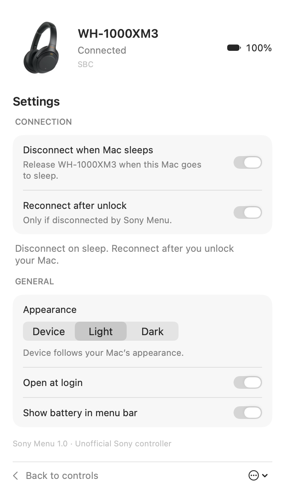

# Sony Menu

Control Sony WH-1000XM3 noise cancellation, ambient sound, and volume from
your Mac’s menu bar. A native SwiftUI app that talks directly to the headphones
over Bluetooth—no phone app, account, server, or package dependencies.

**macOS 14+ · Apple Silicon · Unofficial · MIT-licensed code**

<table>
<tr><th>Headphone controls</th><th>Settings</th></tr>
<tr>
<td><picture><source media="(prefers-color-scheme: dark)" srcset="docs/screenshots/dark-controls.png"></picture></td>
<td><picture><source media="(prefers-color-scheme: dark)" srcset="docs/screenshots/dark-settings.png"></picture></td>
</tr>
</table>

Screenshots are rendered from the native app connected to a WH-1000XM3.
[Light controls](docs/screenshots/light-controls.png) · [Dark controls](docs/screenshots/dark-controls.png) · [Light settings](docs/screenshots/light-settings.png) · [Dark settings](docs/screenshots/dark-settings.png)

## Features

- **Noise control:** Noise Cancelling, Ambient Sound, and Off, with state read
  back from the headphones rather than assuming the command worked.
- **Ambient sound:** level adjustment and Focus on voice.
- **Volume sync:** the slider, macOS controls, and headphone gestures use the
  same Core Audio device volume. External changes update the panel live.
- **Live status:** battery percentage, Bluetooth connection, and codec.
- **Disconnect on sleep:** release the headphones when the Mac sleeps, with
  optional reconnection after unlock. Manual reconnection is the default.
- **Appearance:** Device, Light, or Dark, saved between launches.
- **Menu bar preferences:** battery percentage and optional launch at login.
- **Low background activity:** Bluetooth and volume notifications instead of
  repeating polling timers; bounded retries, cancelled work on sleep, and no
  normal packet logging or keepalive requests.

## Install

1. Download the Apple Silicon `.zip` from
   [Releases](https://github.com/Hopchenko/sony-menu/releases/latest).
2. Unzip it and move **Sony Menu.app** to Applications.
3. Open the app and allow Bluetooth access if prompted.
4. Pair/connect your **WH-1000XM3** in macOS Bluetooth settings, then click the
   headphones icon in the menu bar.

The downloadable app is **ad-hoc signed, not notarized**. macOS may block its
first launch. If you choose to trust this build, follow Apple’s instructions
under [Open apps safely on your Mac](https://support.apple.com/en-gb/102445).
You can also build the app yourself from the source below.

To launch at login, first put the app at its permanent location, then enable
**Settings → Open at login**. macOS may also require approval under
**System Settings → General → Login Items**.

## Compatibility

| Component | Supported / tested |
| --- | --- |
| Headphones | Sony WH-1000XM3; tested with firmware 4.5.2 |
| Mac | Apple Silicon (arm64) |
| macOS | Minimum deployment target 14; hardware validation on macOS 26 |
| Other Sony models | Not validated; shared protocol support does not guarantee compatibility |
| USB | Not required; control uses classic Bluetooth RFCOMM |

## Sleep disconnection

**Disconnect when Mac sleeps** is on by default. Sony Menu closes its control
session and requests disconnection of this headset’s Bluetooth link. It does
not switch off the Mac’s Bluetooth, disconnect other devices, or forget pairing.

**Reconnect after unlock** is off by default. When enabled, the app reconnects
only a link it released for sleep; a background wake alone does not authorize
reconnection. The app respects a manual disconnect.

The app cannot execute during deep sleep or guarantee that macOS will reject
incoming connections while it is suspended. It handles detected reconnects
through Bluetooth notifications when scheduled. Unlock detection uses the
macOS distributed screen-unlock notification, which is not a documented public
AppKit API. Long closed-lid/backpack periods and real login/unlock behavior
still need broader testing. The live diagnostic test verifies the disconnect
handler without putting the computer to sleep.

## Build from source

Requires Xcode with the macOS SDK and command-line tools selected. No dependency
installation is needed.

```sh
git clone https://github.com/Hopchenko/sony-menu.git
cd sony-menu
zsh build.sh
open 'build/Sony Menu.app'
```

The build is created at `build/Sony Menu.app` and signed locally. Quit any
running instance before launching a rebuilt version.

## Tests and validation

```sh
zsh test.sh
```

**49 automated tests** cover framing and stream recovery, Bluetooth command
queues, retries and errors, preferences, appearance, volume synchronization,
sleep/wake intent, lifecycle cleanup, idle behavior, and native panel rendering.
They use simulated hardware and isolated preferences. CI runs the suite on
macOS and uploads coverage, UI previews, and a packaged app.

The generated report is `build/coverage.txt`. Coverage is not 100%: native
Bluetooth/Core Audio adapters are checked separately on real hardware.
See [TESTING.md](TESTING.md) for the test matrix and diagnostic commands,
and [VALIDATION.md](VALIDATION.md) for recorded hardware checks and limitations.

## Privacy and implementation

The app runs locally. It has no network client, analytics, or telemetry.
Preferences are stored in macOS UserDefaults. Normal operation does not collect
packet logs. Explicit developer diagnostics keep a bounded log in memory and
write it to `/private/tmp/sony-menu-diagnostics.json` only when requested.

Source is under `Sources/SonyMenu`: SwiftUI views, an event-driven store,
macOS platform adapters, sleep policy, and a Sony MDR V1 client with an
incremental frame parser and stop-and-wait command queue. Quitting closes the
app’s control session while leaving the audio connection alone.

## Credits and license

Sony protocol code is adapted from the MIT-licensed
[HeadBridge](https://github.com/herenickname/HeadBridge), with the original
protocol work also documented by
[SonyHeadphonesClient](https://github.com/Plutoberth/SonyHeadphonesClient).
Original notices are preserved in
[Resources/ThirdPartyNotices.txt](Resources/ThirdPartyNotices.txt) and the app.

Application code is [MIT licensed](LICENSE). Sony trademarks and product imagery
belong to their respective owners and are not licensed under the MIT license.
Sony Menu is a community project, not affiliated with or endorsed by Sony.

Bug reports and contributions are welcome; see [CONTRIBUTING.md](CONTRIBUTING.md).
