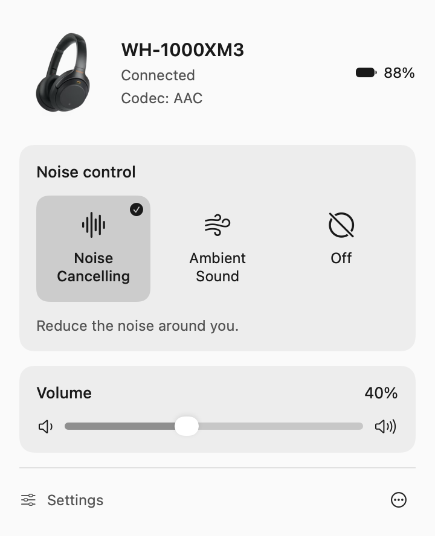
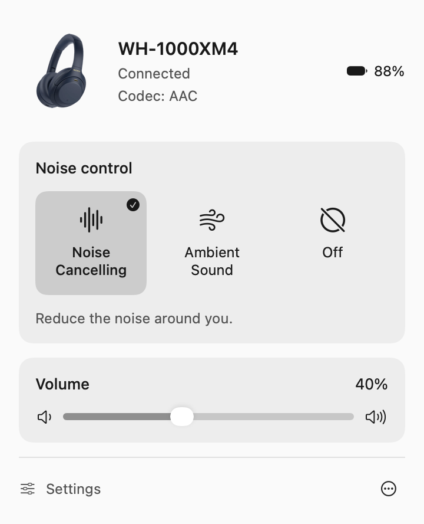
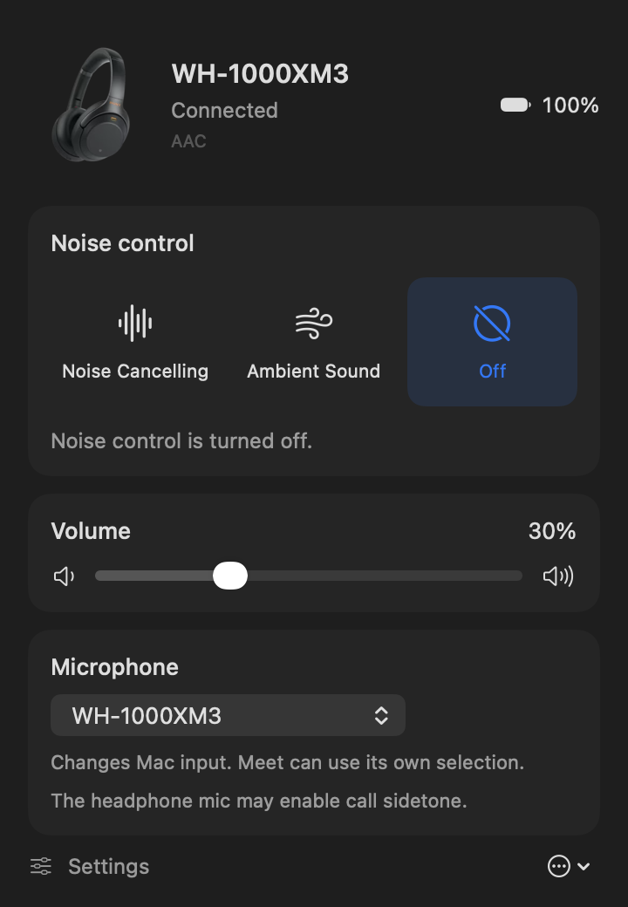
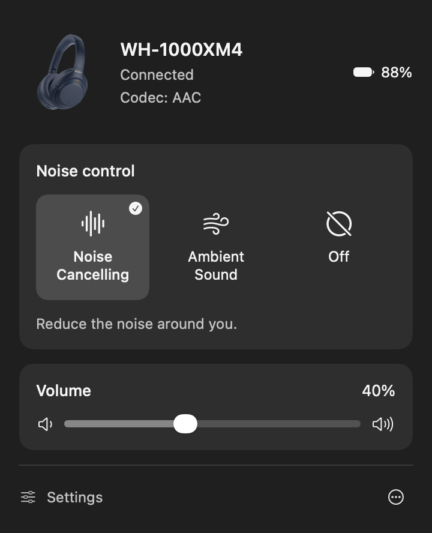
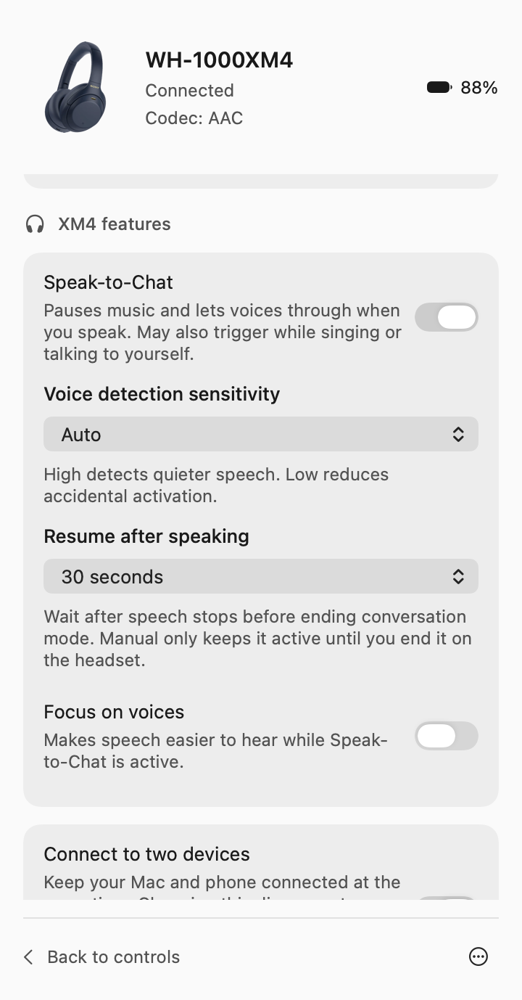
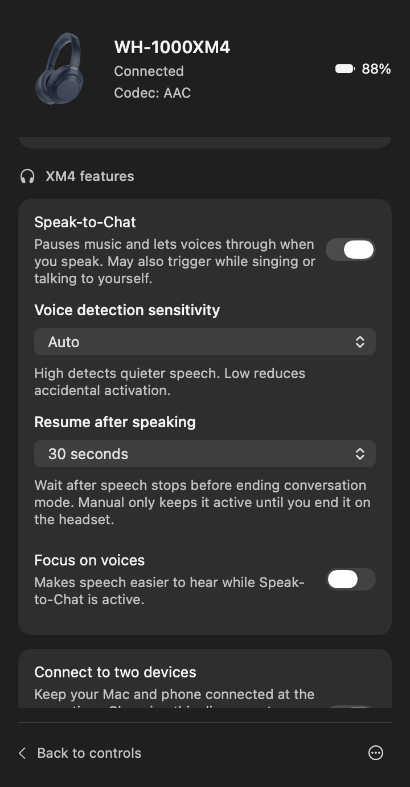
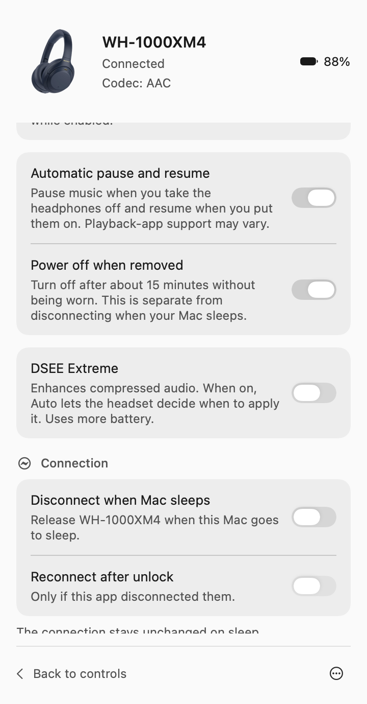
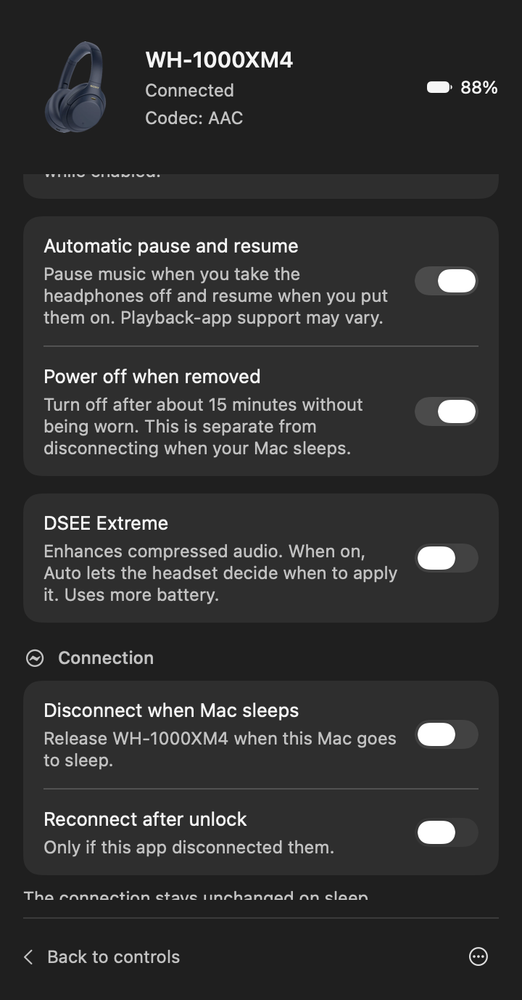
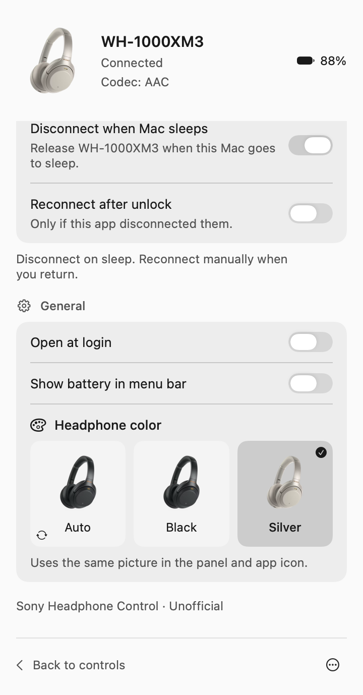
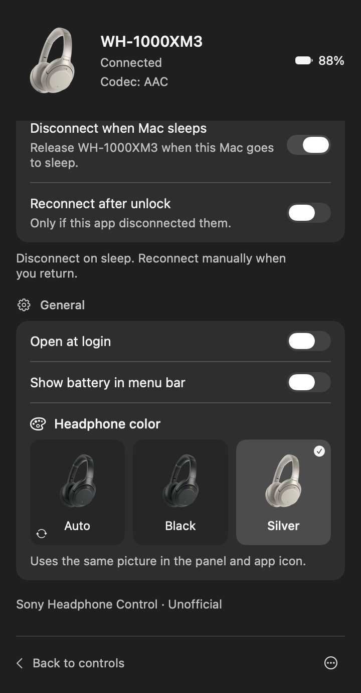

# Sony Headphone Control

Control Sony WH-1000XM3 and WH-1000XM4 noise cancellation, ambient sound, and volume from
your Mac’s menu bar. A native SwiftUI app that talks directly to the headphones
over Bluetooth—no phone app, account, server, or package dependencies.

**[Install ↓](#install)** · [Build from source](#build-from-source)

**macOS 14+ · Apple Silicon · Unofficial · MIT-licensed code**

<table>
<tr><th>WH-1000XM3 · Light</th><th>WH-1000XM4 · Light</th></tr>
<tr><td></td><td></td></tr>
<tr><th>WH-1000XM3 · Dark</th><th>WH-1000XM4 · Dark</th></tr>
<tr><td></td><td></td></tr>
</table>

Both models are shown above. Native UI test renders use representative device
state; the displayed battery and volume values are examples.
[XM3 Light settings](docs/screenshots/light-settings.png) ·
[XM3 Dark settings](docs/screenshots/dark-settings.png) ·
[XM4 overview](docs/screenshots/xm4-overview-light.png) ·
[XM4 multipoint settings](docs/screenshots/xm4-multipoint-light.png)

## Features

- **Noise control:** Noise Cancelling, Ambient Sound, and Off, with state read
  back from the headphones rather than assuming the command worked.
- **XM3 sound quality mode:** choose sound quality or a stable connection in Settings → Audio, with the selected mode read back from the headphones.
- **Ambient sound:** level adjustment and Focus on voice.
- **XM4 features:** Speak-to-Chat and conversation options, multipoint, wearing
  detection and power-off, and DSEE Extreme Off/Auto—with explanations in Settings.
- **Volume sync:** the slider, macOS controls, and headphone gestures use the
  same Core Audio device volume. External changes update the panel live.
- **Live status:** battery percentage, Bluetooth connection, and codec.
- **Microphone selector:** switch the Mac’s default input between available
  microphones whenever you want, with live updates when macOS routing changes.
- **Sleep preferences per headset:** optional disconnect/reconnect behavior.
  Disconnect defaults to On for XM3 and Off for multipoint-capable XM4; saved
  choices take precedence. Reconnection after unlock is optional.
- **Matching artwork:** automatic model/color artwork, including Black, Silver
  and Blue for XM4. The panel and app/Finder icon match, with a manual color
  override remembered separately for each headset.
- **Appearance:** compact Auto / sun / moon control. Auto follows your Mac; Light and Dark override it immediately and persist between launches.
- **Readability:** larger helper text, section icons, named controls, a visible selected-mode checkmark, and scrollable Settings.
- **Stable panel position:** an open panel stays anchored to where you opened it; Settings reserves a separate scrollbar gutter.
- **Menu bar preferences:** battery percentage and optional launch at login.
- **Low background activity:** Bluetooth and volume notifications instead of
  repeating polling timers; bounded retries, cancelled work on sleep, and no
  normal packet logging or keepalive requests.

The quality selector controls Sony’s [sound quality mode](https://helpguide.sony.net/mdr/wh1000xm3/v1/en/contents/TP0001703137.html). Changing it may interrupt audio or reconnect the headset. It does not force a particular codec; the codec label shows what the headphones report.


## Automatic headset selection

The app automatically uses a connected WH-1000XM3 or WH-1000XM4. If both are
connected, it keeps the current target; on startup it prefers the last used
connected headset. When neither is connected, the last selected headset stays
visible with disabled controls and its remembered model/artwork.

Settings → Headphones lists paired devices, including disconnected ones. Choose
a specific device to keep it selected, or Automatic to follow connected devices.
This selects the app's control target without changing the Mac's audio output.
Color choices and sleep/reconnect preferences are saved separately per headset.
Existing XM3 preferences migrate once; appearance and login settings stay global.
A sleeping headset remains the sleep policy's target until unlock.
Automatic detection and connection recovery on XM3/XM4 were confirmed on
real hardware with version 1.5.1. See the [manual test checklist](TESTING.md#xm3xm4-automatic-selection)
and [validation notes](VALIDATION.md).

A [spinner and Connecting status](docs/screenshots/connecting-dark.png) cover service discovery and automatic retries.
If the control service is not ready immediately after Bluetooth connects, the
app retries briefly without needing to close and reopen the panel. A terminal
error appears only after its bounded recovery window ends. When both models
are connected, the panel names the control target and reminds you that Mac audio
output is selected separately.

Disconnect on sleep defaults to On for XM3 and Off for XM4; an explicitly
saved preference takes precedence.

XM4 has Black, Silver and Blue artwork. Auto uses recognized color reports;
unrecognized codes preserve that headset's last known color, with Black as the
initial fallback. Choose a manual color if Auto cannot recognize yours. The
observed XM4 code 0x05 maps to Blue, confirmed on a physically blue headset.
XM4 sound-quality controls are hidden until their protocol support is validated.

## XM4 settings

Settings → XM4 features reads the headset's own settings and includes:

- Speak-to-Chat on/off, Auto/High/Low speech sensitivity, 15-second/30-second/
  1-minute/manual conversation timeout, and conversation voice focus.
- Connect to two devices (multipoint). The description explains possible
  reconnection and the LDAC restriction while enabled.
- Automatic pause/resume when removed and worn again, plus automatic power-off
  after about 15 minutes without being worn. This is separate from Mac sleep.
- DSEE Extreme Off/Auto, with a description of audio enhancement and battery use.

Controls use the headset's actual reported settings and stay disabled when
those settings are unavailable. Changes are confirmed by reading the setting
back. Nothing is automatically enabled when you connect.

Changing multipoint disconnects Bluetooth briefly. The app attempts to reconnect,
but macOS may require a manual reconnect. See [XM4 protocol and validation
notes](docs/xm4-features.md) for the measured behavior and remaining limitations.

<table>
<tr><th>XM4 · Speak-to-Chat settings</th><th>XM4 · Dark conversation settings</th></tr>
<tr><td></td><td></td></tr>
<tr><th>XM4 · Wearing and DSEE</th><th>XM4 · Dark wearing and DSEE</th></tr>
<tr><td></td><td></td></tr>
</table>

## Headphone color

Auto reads the headset's series/color information when connecting and remembers
the last known color while disconnected. Unknown or missing reports keep the
last known image; you can choose **Black**, **Silver**, or **Blue** (XM4) from the photo tiles in
**Settings → General → Headphone color**.

The matching Finder icon persists when the app is closed. Install the app in a
writable location such as Applications so macOS can apply its custom icon.

<table>
<tr><th>XM3 photo selector · Light</th><th>XM3 photo selector · Dark</th></tr>
<tr><td></td><td></td></tr>
</table>

[Silver controls · Light](docs/screenshots/silver-light-controls.png) · [Silver controls · Dark](docs/screenshots/silver-dark-controls.png)

## Install

**Current source version: 1.5.1**, including XM3/XM4 automatic detection, XM4
settings, and connection-progress improvements. To install this version now,
[build from source](#build-from-source).

The latest published download is **1.3.3**, which predates XM4 support.
For the published XM3 release:

1. Download the Apple Silicon `.zip` from
   [Releases](https://github.com/Hopchenko/sony-menu/releases/latest).
2. Quit the previous version, unzip it, and move **Sony Headphone Control.app** to Applications.
   When upgrading from Sony Menu, remove the old **Sony Menu.app** after replacing it. The source installer migrates that name automatically.
3. Open the app and allow Bluetooth access if prompted.
4. Pair/connect your **WH-1000XM3** in macOS Bluetooth settings, then click the
   headphones icon in the menu bar. For **WH-1000XM4**, use the current source build above.

The downloadable app is **ad-hoc signed, not notarized**. macOS may block its
first launch. If you choose to trust this build, follow Apple’s instructions
under [Open apps safely on your Mac](https://support.apple.com/en-gb/102445).
You can also build the app yourself from the source below.

To launch at login, first put the app at its permanent location, then enable
**Settings → Open at login**. macOS may also require approval under
**System Settings → General → Login Items**.

## Compatibility

| Component | Supported / tested |
| --- | --- |
| Headphones | Sony WH-1000XM3 (firmware 4.5.2) and WH-1000XM4; see VALIDATION.md for hardware results |
| Mac | Apple Silicon (arm64) |
| macOS | Minimum deployment target 14; hardware validation on macOS 27.2 |
| Other Sony models | Not validated; shared protocol support does not guarantee compatibility |
| USB | Not required; control uses classic Bluetooth RFCOMM |

## Sleep disconnection

**Disconnect when Mac sleeps** defaults to **On for XM3** and **Off for XM4**. Sony Headphone Control closes its control
session and requests disconnection of this headset’s Bluetooth link. It does
not switch off the Mac’s Bluetooth, disconnect other devices, or forget pairing.

**Reconnect after unlock** is off by default. When enabled, the app reconnects
only a link it released for sleep; a background wake alone does not authorize
reconnection. The app respects a manual disconnect.

The app cannot execute during deep sleep or guarantee that macOS will reject
incoming connections while it is suspended. It handles detected reconnects
through Bluetooth notifications when scheduled. Unlock detection uses the
macOS distributed screen-unlock notification, which is not a documented public
AppKit API. Long closed-lid/backpack periods and real login/unlock behavior
still need broader testing. The live diagnostic test verifies the disconnect
handler without putting the computer to sleep.

## Calls and microphone control

The **Settings → Audio → Microphone** dropdown changes the Mac’s default input without
selecting a different output device. You can switch back and forth at any
time; the app does not choose for you or record audio.

Using the WH-1000XM3 microphone during a call can enable sidetone: microphone
sound is fed back into the earcups so you can hear yourself. This can resemble
Ambient Sound even when the reported noise-control mode has not changed.
Choosing the Mac’s built-in microphone can avoid that headset call behavior.
This is an input-routing workaround, not a firmware sidetone-disable command.

Google Meet and other apps may select their own microphone explicitly. To
follow this selector, use the system default input in the calling app; otherwise
change the microphone in the app’s own audio settings.

**If you hear yourself or surrounding noise in Google Meet:** open Meet’s own
**Settings → Audio → Microphone** and select **MacBook Pro Microphone**, keeping
WH-1000XM3 selected as the speaker. This resolved the reported problem on the
test Mac. Changing macOS's default alone does not override Meet’s explicit
headset-microphone selection.

No working XM3 firmware sidetone-disable command has been established. See the
[read-only capability investigation](docs/xm3-sidetone.md) for the device’s
responses and the limits of this conclusion.

## Build from source

Requires Xcode with the macOS SDK and command-line tools selected. No dependency
installation is needed.

```sh
git clone https://github.com/Hopchenko/sony-menu.git
cd sony-menu
zsh build.sh
zsh install.sh
open '/Applications/Sony Headphone Control.app'
```

The build is created at `build/Applications.noindex/Sony Headphone Control.app` and signed locally. The `.noindex` directory keeps development copies out of Spotlight. Builds also retire this project’s older generated app copies; the installer replaces only this app’s cached launcher registration for the single copy in Applications. This also addresses a stale entry that could appear in search but be missing from the full Apps grid. Quit any
running instance before launching a rebuilt version.

To install the built app in Applications, run `zsh install.sh`. A native icon
is included, so Sony Headphone Control can be found in Finder, Applications and Spotlight.

### Stable local signing and Bluetooth permission

Ad-hoc signatures change identity when the executable changes, so macOS may
request Bluetooth permission again after a rebuild. A stable local signing
certificate keeps the app's designated identity consistent across builds.

For a local development installation, an explicit one-time setup is available:

```sh
zsh Tools/create-local-signing-identity.sh
zsh build.sh
zsh install.sh
open '/Applications/Sony Headphone Control.app'
```

The setup reuses the established `Sony Menu Local Signing` identity in the user's keychain and
adds user-level trust scoped to code signing. It does not change system-wide
or TLS trust. The private key remains in the keychain; temporary key files are
removed. It reuses that identity on future runs. macOS may ask for Keychain
approval during setup and one Bluetooth approval when migrating from the old
ad-hoc identity. Keep launching the installed app from the same path.

This is **local signing**, not Apple Developer ID signing or notarization.
Public download builds remain ad-hoc signed. If you have your own Apple-issued
identity, set `SONY_MENU_SIGNING_IDENTITY` to its identity name or fingerprint.
Set `SONY_MENU_SIGNING_IDENTITY=-` to explicitly build ad-hoc (as release CI does).

## Tests and validation

```sh
zsh test.sh
```

**115 automated tests** cover framing and stream recovery, Bluetooth command
queues, retries and errors, preferences, appearance, volume synchronization,
sleep/wake intent, microphone routing and readback, lifecycle cleanup, idle
behavior, and native panel rendering.
Five additional signature-integrity tests ensure custom Finder-icon metadata cannot hide changed signed resources.
They use simulated hardware and isolated preferences. CI runs the suite on
macOS and uploads coverage, UI previews, and a packaged app.

The generated report is `build/coverage.txt`. Coverage is not 100%: native
Bluetooth/Core Audio adapters are checked separately on real hardware.
See [TESTING.md](TESTING.md) for the test matrix and diagnostic commands,
and [VALIDATION.md](VALIDATION.md) for recorded hardware checks and limitations.

## Mac battery and idle activity

The app has no repeating idle status queries, keepalives, battery sampling, or
continuous device scans. Bluetooth/Core Audio notifications drive updates.
Connection retries are bounded. XM4 setting verification is temporary and is
cancelled when it completes, you switch devices, disconnect, sleep, or quit.

The current idle audit found effectively zero process CPU use, zero measured
wakeups, stable memory, and no disk I/O in two 30-second background samples.
This checks idle behavior; it is not a whole-Mac battery-life benchmark.
See [the audit and reproduction steps](docs/performance.md).

## Privacy and implementation

The app runs locally. It has no network client, analytics, or telemetry.
Preferences are stored in macOS UserDefaults. Normal operation does not collect
packet logs. Explicit developer diagnostics keep a bounded log in memory and
write it to `/private/tmp/sony-menu-diagnostics.json` only when requested.

Source is under `Sources/SonyMenu`: SwiftUI views, an event-driven store,
macOS platform adapters, sleep policy, and a Sony MDR V1 client with an
incremental frame parser and stop-and-wait command queue. Quitting closes the
app’s control session while leaving the audio connection alone.

## Credits and license

Sony protocol code is adapted from the MIT-licensed
[HeadBridge](https://github.com/herenickname/HeadBridge), with the original
protocol work also documented by
[SonyHeadphonesClient](https://github.com/Plutoberth/SonyHeadphonesClient).
Original notices are preserved in
[Resources/ThirdPartyNotices.txt](Resources/ThirdPartyNotices.txt) and the app.

Application code is [MIT licensed](LICENSE). Sony trademarks and product imagery
belong to their respective owners and are not licensed under the MIT license.
Sony Headphone Control is a community project, not affiliated with or endorsed by Sony.

Bug reports and contributions are welcome; see [CONTRIBUTING.md](CONTRIBUTING.md).
